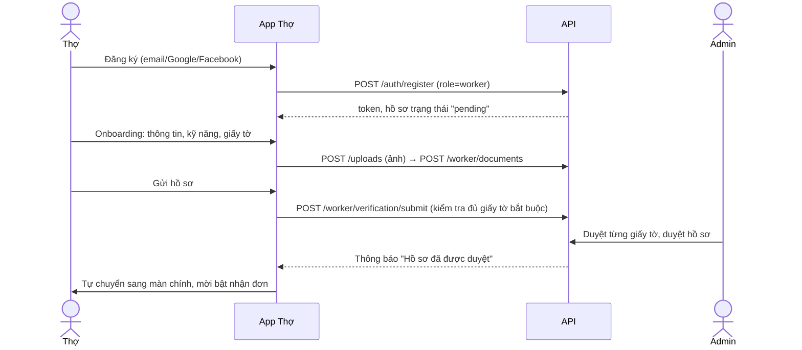
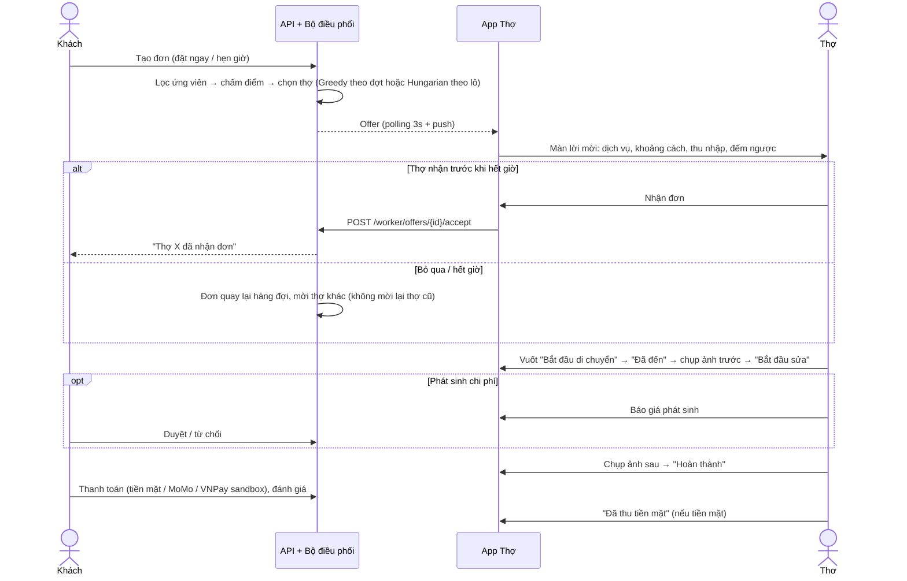
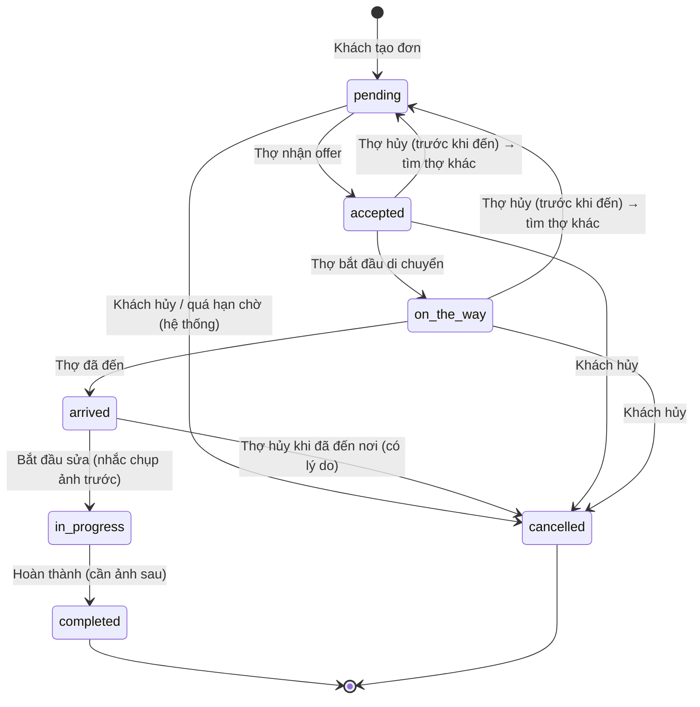
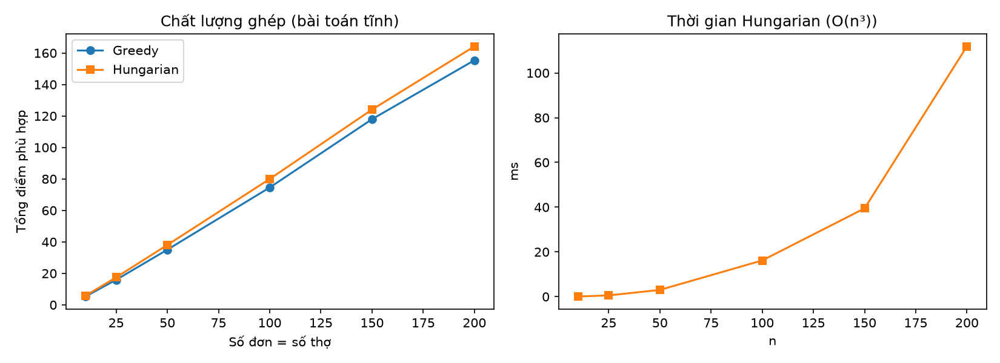
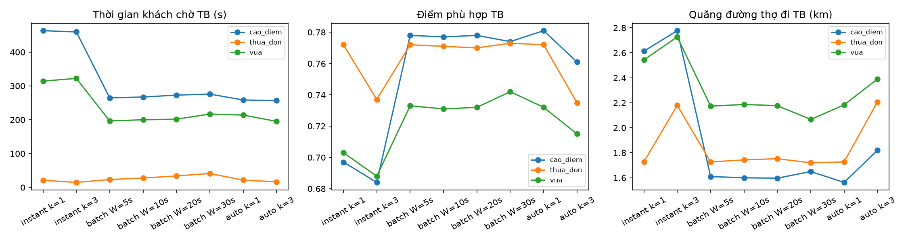

# Thiết kế App Thợ & thuật toán ghép cặp — THỢ NHANH

> Phần việc của **Thành viên B**: App Thợ (React Native/Expo) + backend liên quan (FastAPI) + thuật toán ghép cặp (tức thời, theo lô, tự động hybrid).
> Tài liệu này viết để dùng lại cho Chương 3 (phân tích – thiết kế), Chương 4 (xây dựng) và Chương 5 (kiểm thử – thực nghiệm) của báo cáo.

Mục lục

1. [Phạm vi và các quyết định chính](#1-phạm-vi-và-các-quyết-định-chính)
2. [Tham khảo các ứng dụng tương tự](#2-tham-khảo-các-ứng-dụng-tương-tự)
3. [Use case của thợ](#3-use-case-của-thợ)
4. [Các luồng nghiệp vụ chính](#4-các-luồng-nghiệp-vụ-chính)
5. [Máy trạng thái đơn hàng](#5-máy-trạng-thái-đơn-hàng)
6. [Thuật toán ghép cặp](#6-thuật-toán-ghép-cặp)
7. [Bộ điều phối (dispatcher)](#7-bộ-điều-phối-dispatcher)
8. [Thu nhập, ví và hoa hồng](#8-thu-nhập-ví-và-hoa-hồng)
9. [Thay đổi cơ sở dữ liệu](#9-thay-đổi-cơ-sở-dữ-liệu)
10. [API cho App Thợ](#10-api-cho-app-thợ)
11. [Kiến trúc App Thợ](#11-kiến-trúc-app-thợ)
11b. [Thiết kế giao diện](#11b-thiết-kế-giao-diện)
12. [Kiểm thử](#12-kiểm-thử)
13. [Thực nghiệm so sánh các chế độ ghép cặp](#13-thực-nghiệm-so-sánh-các-chế-độ-ghép-cặp)
14. [Hạn chế và hướng phát triển](#14-hạn-chế-và-hướng-phát-triển)

---

## 1. Phạm vi và các quyết định chính

| Chủ đề | Quyết định | Lý do |
|---|---|---|
| Ngành nghề | Chỉ **thợ điện** (danh mục: Sửa chữa điện, Lắp đặt điện, Cầu dao & tủ điện, An toàn điện – 11 dịch vụ) | Nhóm chốt thu hẹp phạm vi; dữ liệu seed, icon, giấy tờ ("Chứng chỉ nghề điện") đều theo hướng này. Cấu trúc danh mục vẫn mở rộng được. |
| Đăng nhập | Email + mật khẩu, Google, Facebook. **Bỏ SMS OTP** | SMS OTP tốn phí. Quên mật khẩu bằng mã 6 số gửi qua email (SMTP miễn phí, VD Gmail). |
| Bản đồ | **MapLibre GL + OpenFreeMap** (bản đồ vector), tự chuyển sang **Leaflet + OpenStreetMap** nếu máy không có WebGL hoặc không tải được | Miễn phí, không cần API key, không giới hạn lượt. Không dùng CARTO: từ 08/2026 CARTO bắt buộc API key (ảnh nền hiện chữ "API KEY REQUIRED"). Máy chủ ảnh của OpenStreetMap từ 03/2026 bắt buộc có Referer nên chỉ dùng làm dự phòng (app gửi Referer + User-Agent đúng chính sách). Thư viện bản đồ nhúng sẵn trong app (không phụ thuộc CDN). Dẫn đường: mở Google Maps/Apple Maps của máy. |
| Ai chọn thợ? | **Hệ thống gửi lời mời (offer) cho thợ**, thợ nhận/bỏ qua — giống Grab, bTaskee | Khách không phải tự chọn trong danh sách; thuật toán ghép cặp thực sự quyết định. Chế độ ghép (tức thời / theo lô) do **admin** cấu hình, không do khách chọn. |
| Realtime | **Polling** (TanStack Query, 3–15 giây tuỳ màn) + **Expo Push** (khi có development build) | Đủ cho quy mô đồ án, đơn giản, chạy được cả web lẫn Expo Go; không phải duy trì kết nối WebSocket. |
| Tiền | Mô hình **ví thợ** kiểu Grab: online → cộng thực nhận; tiền mặt → trừ hoa hồng 15% (ví có thể âm tới −500.000đ) | Phản ánh đúng thực tế thợ thu tiền mặt tại nhà khách. |
| Đóng gói | Mỗi phần là 1 Docker image; `docker compose up` là chạy | Theo yêu cầu nhóm. |

## 2. Tham khảo các ứng dụng tương tự

| Ứng dụng | Điều học được | Áp dụng trong App Thợ |
|---|---|---|
| Grab Driver / Be Driver | Lời mời nhận chuyến toàn màn hình, đếm ngược, hiện **thu nhập thực nhận** trước khi nhận; vuốt để chuyển trạng thái; ví tài xế bị trừ hoa hồng khi khách trả tiền mặt | Màn lời mời (OfferCenter) hiện ở mọi màn, rung máy, vòng đếm ngược, khoảng cách + ETA, thu nhập dự kiến; nút **vuốt để xác nhận** (tránh bấm nhầm khi đang đi đường); ví âm có hạn mức, nạp tiền để trả nợ |
| bTaskee, Rada (đối tác dịch vụ tại nhà) | Trang chủ là **việc và lịch hẹn**, không phải bản đồ; công việc đặt lịch trước; khu vực nhận việc | Trang chủ = trạng thái nhận đơn + việc đang làm + số liệu hôm nay + lịch hẹn; bản đồ chỉ ở lời mời và chi tiết việc. Đơn hẹn trước: lời mời ghi rõ giờ hẹn, thợ tự quyết; hệ thống chặn trùng lịch; chỉ được xuất phát trong 60 phút trước giờ hẹn |
| Urban Company (partner app) | Chuẩn hoá quy trình tại nhà khách: ảnh trước/sau, báo giá phát sinh cần khách đồng ý, chỉ số hiệu suất (tỷ lệ nhận, tỷ lệ hủy, đánh giá) | Ảnh "sau" bắt buộc trước khi hoàn thành, ảnh "trước" được nhắc chụp khi bắt đầu sửa; báo giá phát sinh khách duyệt trong app; màn Hiệu suất 30 ngày |

Nguyên tắc UX rút ra cho thợ (người dùng đang di chuyển, tay bẩn, ngoài trời):
- Nút to, chữ to, tương phản cao; thao tác chính ở nửa dưới màn hình; 1 hành động chính mỗi màn.
- Hiện **tiền thợ thực nhận** (đã trừ hoa hồng), không chỉ giá khách trả.
- Không lộ số điện thoại của khách khi chưa nhận việc (lời mời chỉ hiện tên gọi, địa chỉ, khoảng cách); số điện thoại chỉ hiện khi đang làm đơn và 7 ngày sau khi hoàn thành (để liên hệ bảo hành).
- Mọi thao tác có hậu quả (hủy đơn, xác nhận đã đến khi còn xa > 500 m, rút tiền) đều có hộp thoại xác nhận.
- Lỗi mạng không làm mất thao tác: hiển thị trạng thái lỗi + nút thử lại; dữ liệu tự làm mới khi app quay lại.

## 3. Use case của thợ

| Mã | Use case | Ghi chú |
|---|---|---|
| UC01 | Đăng ký tài khoản thợ (email + mật khẩu) | Hoặc Google / Facebook (tự liên kết nếu trùng email) |
| UC02 | Đăng nhập / đăng xuất / quên mật khẩu / đổi mật khẩu | Mã quên mật khẩu 6 số, hết hạn 15 phút, tối đa 5 lần nhập sai |
| UC03 | Hoàn thiện hồ sơ nghề nghiệp (onboarding) | 4 bước: thông tin cá nhân → kỹ năng (dịch vụ) → giấy tờ → gửi duyệt |
| UC04 | Tải giấy tờ xác minh | CCCD mặt trước/sau, ảnh chân dung (bắt buộc), chứng chỉ nghề điện (khuyến khích) |
| UC05 | Theo dõi kết quả duyệt hồ sơ | Bị từ chối giấy tờ nào thì thấy lý do & tải lại đúng giấy tờ đó |
| UC06 | Bật/tắt nhận đơn | Chỉ khi đã duyệt; app gửi vị trí định kỳ khi đang bật |
| UC07 | Nhận lời mời đơn & chấp nhận / bỏ qua | Đếm ngược; bỏ qua có chọn lý do |
| UC08 | Xem danh sách công việc (đang làm kể cả lịch hẹn / hoàn thành / đã hủy) | |
| UC09 | Thực hiện đơn: đang đến → đã đến → bắt đầu sửa → hoàn thành | Vuốt để xác nhận; dẫn đường; gọi / chat với khách. Đơn hẹn trước chỉ bắt đầu di chuyển được trong 60 phút trước giờ hẹn |
| UC10 | Chụp ảnh trước/sau khi sửa | Ảnh "sau" bắt buộc trước khi hoàn thành; ảnh "trước" được nhắc khi bắt đầu sửa |
| UC11 | Gửi báo giá phát sinh | Chỉ sau khi đã đến nơi xem hiện trạng; khách duyệt/từ chối trên app khách; thợ có thể rút lại báo giá đang chờ |
| UC12 | Xác nhận đã thu tiền mặt | Ghi hoa hồng vào ví |
| UC13 | Hủy đơn đã nhận (có lý do) | Trước khi đến nơi: đơn quay lại hàng đợi tìm thợ khác; đã đến nơi: hủy đơn |
| UC14 | Báo cáo sự cố (khách vắng mặt, không thanh toán, tranh chấp...) | Tạo khiếu nại cho admin |
| UC15 | Chat với khách theo đơn | |
| UC16 | Xem thu nhập theo ngày/tuần/tháng + biểu đồ | |
| UC17 | Quản lý ví: số dư, lịch sử giao dịch, rút tiền, nạp tiền trả nợ hoa hồng | Rút tiền tối thiểu 50.000đ, cần tài khoản ngân hàng |
| UC18 | Xem lịch hẹn sắp tới, được nhắc trước giờ hẹn 60 phút | Không có khung giờ làm việc theo tuần: bật = nhận đơn, tắt = nghỉ (xem mục 11c) |
| UC19 | Cài đặt khu vực & bán kính nhận việc (chọn trên bản đồ) | |
| UC20 | Xem đánh giá của khách & hiệu suất 30 ngày | |
| UC21 | Nhận thông báo (trong app + push) | |
| UC22 | Xem bản đồ lớn của đơn (vị trí thợ – nhà khách) | Chạm bản đồ nhỏ ở chi tiết việc để mở toàn màn hình; nút căn lại khung, dẫn đường |
| UC23 | Kiểm tra an toàn điện trước khi sửa | 4 mục bắt buộc; server lưu thời điểm xác nhận (`safety_checked_at`) |
| UC24 | Báo giá nhanh từ bảng giá vật tư/công tham khảo | Thợ vẫn sửa được nội dung, số tiền; khách phải đồng ý |
| UC25 | Xem hạng thợ và điều kiện lên hạng | Đồng / Bạc / Vàng / Kim cương — chỉ hiển thị, không ảnh hưởng ghép đơn |
| UC26 | Chia sẻ địa chỉ đang làm cho người thân | Mở hộp chia sẻ của điện thoại (Zalo, SMS...) |

Use case phía **admin** liên quan tới thợ (web quản trị của thành viên khác dùng API có sẵn + API mới):
duyệt từng giấy tờ, duyệt/từ chối hồ sơ, cấu hình matching (trọng số, chế độ, bán kính, số offer, timeout, cửa sổ lô), xem/duyệt yêu cầu rút tiền.

## 4. Các luồng nghiệp vụ chính

### 4.1. Đăng ký → xác minh → được nhận việc



Hồ sơ bị từ chối → app hiện lý do từng giấy tờ, thợ tải lại → gửi lại. Thợ chưa duyệt **không** xuất hiện trong ghép cặp.

### 4.2. Nhận đơn và làm việc



### 4.3. Thanh toán và ví
Xem [mục 8](#8-thu-nhập-ví-và-hoa-hồng).

## 5. Máy trạng thái đơn hàng



| Từ | Sang | Ai | Điều kiện / tác động |
|---|---|---|---|
| pending | accepted | Thợ | Offer còn hạn; thợ không giữ việc "làm ngay" khác; khóa dòng đơn → ai nhận trước thắng, offer còn lại bị thu hồi |
| accepted | on_the_way | Thợ | Báo khách thợ đang tới; bắt đầu gửi vị trí để khách theo dõi. Đơn hẹn: hệ thống nhắc thợ trước giờ hẹn 60 phút |
| on_the_way | arrived | Thợ | App hỏi lại nếu GPS còn cách > 500 m |
| arrived | in_progress | Thợ | **Bắt buộc** gửi `safety_confirmed=true` (thợ đã tick đủ checklist an toàn điện); server lưu `safety_checked_at`. App nhắc chụp ảnh hiện trạng |
| in_progress | completed | Thợ | Cần ≥ 1 ảnh "sau"; không còn báo giá chờ duyệt; tạo bảo hành 30 ngày; ghi thu nhập dự kiến |
| accepted/on_the_way | pending | Thợ hủy | Offer của thợ → `cancelled`; đơn vào lại hàng đợi, **không** mời lại thợ này |
| arrived | cancelled | Thợ hủy | Lý do bắt buộc, báo khách |
| pending/accepted/on_the_way | cancelled | Khách / hệ thống | Hệ thống hủy khi quá `DISPATCH_MAX_WAIT_MINUTES` (đặt ngay) hoặc trước giờ hẹn 15 phút mà chưa có thợ |

Trạng thái `matched` có trong schema cũ nhưng **không dùng** (offer đã đóng vai trò "đã ghép, chờ thợ xác nhận").

## 6. Thuật toán ghép cặp

### 6.1. Bài toán
Cho tập đơn đang chờ $O$ và tập thợ $W$. Cần chọn thợ gửi lời mời cho mỗi đơn sao cho khách chờ ít, thợ phù hợp (gần, uy tín, giá hợp lý, không quá tải) và — ở chế độ lô — **tổng độ phù hợp toàn hệ thống lớn nhất**.

Quy trình 3 bước, dùng chung cho cả 2 chế độ:

1. **Lọc không gian** (thuật toán của thành viên C – PostGIS/geohash): thợ trong bán kính tìm $R$ quanh đơn **và** khách nằm trong bán kính nhận việc của thợ.
2. **Lọc ràng buộc cứng** (thành viên B):
   - hồ sơ đã duyệt, tài khoản đang hoạt động, có kỹ năng đúng dịch vụ;
   - vị trí còn mới (≤ `LOCATION_MAX_AGE_MINUTES` = 10 phút);
   - đơn đặt ngay: thợ đang `online` (rảnh); đơn hẹn trước: `online` hoặc `busy`;
   - không đang giữ lời mời khác (mỗi thợ tối đa 1 offer sống);
   - **chưa từng được mời đơn này** (ràng buộc UNIQUE(order_id, worker_id));
   - ví không âm quá hạn mức (−500.000đ);
   - đơn hẹn: không trùng lịch hẹn khác của thợ trong ±120 phút (lời mời ghi rõ giờ hẹn để thợ tự quyết nhận hay không).
3. **Chấm điểm** Weighted Scoring rồi chọn theo chế độ.

### 6.2. Hàm điểm (Weighted Scoring)

$$S(o,w) = w_d\,s_d + w_t\,s_t + w_p\,s_p + w_l\,s_l,\qquad \sum w = 1,\; s_\ast \in [0,1] \Rightarrow S \in [0,1]$$

| Tiêu chí | Công thức | Ý nghĩa |
|---|---|---|
| Khoảng cách $s_d$ | $\max(0,\,1 - d/R)$ | $d$: khoảng cách thợ–khách (km), $R$: bán kính tìm |
| Tin cậy $s_t$ | `trust_score` ∈ [0,1] | Kết quả thuật toán Trust Score (thành viên A) — đã gộp đánh giá, độ mới, số lượng đánh giá |
| Giá $s_p$ | $\mathrm{clamp}(2 - r)$, chưa có lịch sử: 0,5 | $r$ = TB(giá chốt / giá gốc) trong 90 ngày; thợ hay báo giá cao bị điểm thấp |
| Tải công việc $s_l$ | $1 - \min(k,3)/3$ | $k$: số đơn đang làm dở / đã nhận chưa xong |

Trọng số mặc định $(w_d, w_t, w_p, w_l) = (0{,}4;\,0{,}3;\,0{,}1;\,0{,}2)$, admin chỉnh trên web quản trị (bảng `matching_configs`, bản đang `is_active`). Các tiêu chí này khớp với bảng mô tả tiêu chí ở web quản trị (`components/matching/factors.ts`).

### 6.3. Chế độ 1 — Tức thời (Weighted Scoring + Greedy theo đợt)

```
khi có đơn mới o (hoặc đến hạn thử lại):
    C ← các thợ hợp lệ (bước 1 + 2), bỏ các thợ đã từng mời
    sắp xếp C giảm dần theo S(o, w)
    gửi offer cho top-k (k = max_offers), hạn T = offer_timeout_seconds
    nếu C rỗng: thử lại sau DISPATCH_RETRY_SECONDS (20 s)
khi thợ nhận: khoá đơn → thợ đầu tiên nhận thắng → thu hồi các offer còn lại
khi hết T mà không ai nhận: đợt tiếp theo với các thợ xếp sau
quá deadline: hủy đơn, báo khách
```

Độ phức tạp mỗi đợt: $O(c\log c)$ với $c$ = số ứng viên sau lọc không gian.
Đánh đổi của $k$: $k$ lớn → khách chờ ít hơn nhưng "ai nhanh tay thì được", điểm phù hợp TB giảm (xem thực nghiệm); làm phiền nhiều thợ hơn.

### 6.4. Chế độ 2 — Theo lô (Batch Optimal Assignment, Hungarian)

Cứ mỗi `batch_window_seconds` (W), gom **mọi** đơn chế độ lô đang chờ (không có offer sống) và mọi thợ hợp lệ của chúng, dựng ma trận điểm $n \times m$:

$$\text{score}[i][j] = \begin{cases} S(o_i, w_j) & \text{nếu cặp hợp lệ}\\ \varnothing & \text{ngược lại}\end{cases}$$

Mục tiêu: chọn tập cặp không trùng hàng/cột sao cho (1) **số cặp hợp lệ lớn nhất**, rồi (2) **tổng điểm lớn nhất**.

Quy về bài toán gán chi phí nhỏ nhất chuẩn:

$$\text{cost}[i][j] = \begin{cases} 1 - S(o_i,w_j) \in [0,1] & \text{hợp lệ}\\ \mathrm{BIG} = \min(n,m) + 1 & \text{không hợp lệ}\end{cases}$$

*Vì sao đúng:* mọi lời giải gán đủ $\min(n,m)$ cặp. Tổng chi phí của toàn bộ cặp hợp lệ $\le \min(n,m) < \mathrm{BIG}$, nên thêm 1 cặp BIG luôn tệ hơn mọi cách dùng cặp hợp lệ → lời giải tối ưu dùng ít cặp BIG nhất (= nhiều cặp hợp lệ nhất). Với cùng số cặp hợp lệ $q$: $\sum(1 - S) = q - \sum S$ nên cực tiểu chi phí ⇔ cực đại tổng điểm. Cặp BIG trong lời giải bị bỏ (đơn chờ lượt sau).

*Cài đặt* (`app/matching/hungarian.py`, tự viết, không dùng thư viện): Hungarian với thế vị $u, v$ và đường tăng ngắn nhất kiểu Dijkstra; nếu $n > m$ thì chuyển vị. Độ phức tạp $O(n^2 m)$ với $n \le m$, tức $O(n^3)$ khi $n \approx m$. Kiểm chứng bằng **304 ca so với vét cạn** (mục 12).

Mỗi đơn được gán → gửi offer cho đúng thợ được gán (hạn T). Thợ từ chối/hết hạn → đơn vào lượt lô kế tiếp, không mời lại thợ đó.

### 6.5. Vì sao 2 chế độ cho kết quả khác nhau — ví dụ
Đơn A đến trước, đơn B đến sau 2 giây. Thợ X cách A 1 km, cách B 1,2 km; thợ Y cách A 1,5 km, cách B 4,5 km (bán kính 5 km).
- Greedy: A lấy X (điểm khoảng cách 0,8) → B chỉ còn Y (0,1). Tổng 0,9.
- Hungarian: A–Y (0,7) + B–X (0,76). Tổng 1,46 — cả hai khách đều có thợ gần.

### 6.6. Chế độ 3 — Tự động (hybrid, mặc định khi demo)
Hai chế độ trên mạnh ở hai hoàn cảnh khác nhau (xem thực nghiệm mục 13): vắng khách thì tức thời nhanh hơn vì không phải chờ cửa sổ lô; đông khách thì Hungarian tốt hơn hẳn vì tránh "đơn đến trước chiếm thợ tốt". Chế độ **auto** để hệ thống tự chọn ở **từng nhịp điều phối (2 giây)**, không cần admin canh giờ cao điểm:
1. Gom các đơn đang chờ (chưa có lời mời còn hạn), xếp hạng ứng viên hợp lệ của từng đơn như 2 chế độ kia.
2. Chia đơn thành **nhóm tranh chấp**: hai đơn chung ít nhất 1 thợ ứng viên thì cùng nhóm, nối bắc cầu — cài đặt bằng Union-Find (`app/matching/grouping.py`).
3. Nhóm chỉ có 1 đơn → không ai tranh thợ của đơn đó, ghép tham lam đã tối ưu → **gửi ngay cho top-k** (như tức thời).
4. Nhóm ≥ 2 đơn → **Hungarian trên riêng nhóm đó**, mỗi đơn 1 lời mời. Các nhóm độc lập nên giải riêng cho cùng kết quả với giải chung mà ma trận nhỏ hơn.

Đơn ghi lại chế độ **thực tế** đã dùng (`orders.matching_mode`, `order_offers.mode` = `instant` | `batch`) để thống kê. Admin vẫn chọn được 1 trong 3 chế độ ở web quản trị (VD ép `batch` để thực nghiệm).

## 7. Bộ điều phối (dispatcher)

Tiến trình nền khởi động cùng API (`app/services/dispatcher.py`), mỗi `DISPATCHER_TICK_SECONDS` (2 s):

1. Hết hạn các offer quá giờ → đơn tương ứng được thử lại ngay.
2. Chế độ tức thời: gửi đợt kế tiếp cho các đơn đến hạn; nhận các đơn "mồ côi" (tạo bằng script/trước khi có tính năng).
3. Chế độ lô: đủ W giây thì chạy 1 lượt Hungarian.
4. Hủy đơn quá hạn chờ; nhắc thợ trước giờ hẹn 60 phút.

An toàn đồng thời:
- **Khoá advisory PostgreSQL** cho mọi quyết định điều phối (`pg_advisory_xact_lock`) → 2 đơn không thể cùng "giành" 1 thợ.
- **Leader lock** (`pg_try_advisory_lock`) → chạy nhiều tiến trình API (nhiều worker uvicorn / nhiều container) thì chỉ 1 bộ điều phối hoạt động.
- Nhận offer khoá dòng đơn (`SELECT … FOR UPDATE`) → đúng 1 thợ thắng; các offer còn lại của đơn → `expired`.

## 8. Thu nhập, ví và hoa hồng

Hoa hồng nền tảng $c = 15\%$ (`COMMISSION_RATE`). Với tổng tiền đơn $P$ (giá gốc + báo giá phát sinh đã duyệt):

| Khách trả | Ghi nhận | Ví thợ |
|---|---|---|
| Online (MoMo/VNPay sandbox) | Nền tảng thu $P$ | **+ (P − cP)** (thực nhận) |
| Tiền mặt | Thợ cầm $P$; thợ bấm "Đã thu tiền" | **− cP** (nợ hoa hồng) |

Ví dụ: đơn 400.000đ trả tiền mặt → ví −60.000đ, thợ thực nhận 340.000đ (đang cầm). Ví âm quá −500.000đ → tạm không nhận đơn mới cho đến khi nạp tiền.
Rút tiền: ≥ 50.000đ, không vượt số dư khả dụng, cần tài khoản ngân hàng; bản demo tự duyệt (`WITHDRAWAL_AUTO_APPROVE=true`), admin vẫn có API duyệt/từ chối.
Mỗi biến động ví là 1 dòng `wallet_transactions` (sổ cái, có UNIQUE theo đơn + loại để không ghi trùng).

## 9. Thay đổi cơ sở dữ liệu

Migration `backend/db/migrations/002_worker_app.sql` (idempotent, tự chạy khi container API khởi động qua `db/migrate.py`, lưu lịch sử ở bảng `schema_migrations`):

| Thay đổi | Mục đích |
|---|---|
| `users.phone` bỏ NOT NULL | Đăng ký bằng email / Google / Facebook không cần SĐT |
| Bảng `password_reset_codes` | Mã quên mật khẩu (hash, hạn, số lần thử) |
| `worker_profiles.submitted_at` | Thời điểm gửi hồ sơ |
| Index GiST `worker_profiles(location)`, index `availability` | Truy vấn không gian nhanh (schema cũ thiếu GiST) |
| Bảng `worker_bank_accounts` | Tài khoản nhận tiền |
| Bảng `order_photos` | Ảnh trước/sau |
| `order_offers`: `expires_at`, `round`, `mode`, `reason`; trạng thái `sent / accepted / rejected / expired / cancelled` | Vòng đời offer |
| `order_extra_quotes`: thêm trạng thái `cancelled` | Thợ rút báo giá |
| Bảng `order_dispatches` | Hàng đợi điều phối (lần thử kế tiếp, hạn chót, số đợt, số offer) |
| Bảng `wallet_transactions`, `worker_withdrawals` | Ví thợ |
| Bảng `worker_location_logs` | Lịch sử vị trí (theo dõi đường đi) |
| Các index phụ (messages, earnings, payments, orders, history) | Hiệu năng các màn danh sách |
| *Migration 003:* `orders.safety_checked_at` | Lưu vết thợ đã xác nhận kiểm tra an toàn điện lúc bắt đầu sửa (căn cứ khi có sự cố / tranh chấp) |
| *Migration 004:* xóa bảng `worker_schedules` (tạo ở 002) | Bỏ khung giờ làm việc theo tuần (mục 11c) |
| *Migration 005:* `matching_configs.mode`, `order_dispatches.mode` nhận thêm `auto` | Chế độ ghép tự động hybrid (mục 6.6) |

## 10. API cho App Thợ

Tiền tố `/api/v1`, xác thực Bearer JWT, phản hồi dạng `{success, message, data}`. Tài liệu đầy đủ: `http://localhost:8000/docs`.

| Nhóm | Endpoint |
|---|---|
| Xác thực | `POST /auth/register`, `POST /auth/login` (email hoặc SĐT, kèm `role`), `GET /auth/providers`, `POST /auth/google`, `POST /auth/facebook`, `POST /auth/forgot-password`, `POST /auth/reset-password`, `POST /auth/change-password`, `GET /auth/me` |
| Hồ sơ | `GET /worker/me`, `PATCH /worker/profile`, `PUT /worker/services`, `GET/POST /worker/documents`, `DELETE /worker/documents/{id}`, `POST /worker/verification/submit`, `GET/PUT /worker/bank-account` |
| Trang chủ & trạng thái | `GET /worker/home` (trạng thái nhận đơn, việc đang làm, lịch hẹn, hạng thợ `level`, số liệu hôm nay & 7 ngày), `PATCH /worker/availability`, `PATCH /worker/location` |
| Lời mời | `GET /worker/offers/current`, `POST /worker/offers/{id}/accept`, `POST /worker/offers/{id}/reject` |
| Công việc | `GET /worker/orders?group=active\|completed\|cancelled\|history`, `GET /worker/orders/{id}`, `POST …/status`, `POST …/cancel`, `POST …/photos`, `DELETE …/photos/{photo_id}`, `POST …/extra-quotes`, `POST …/extra-quotes/{qid}/cancel`, `POST …/confirm-cash`, `POST …/report`, `GET /worker/reports` |
| Thu nhập & ví | `GET /worker/earnings/summary`, `GET /worker/earnings`, `GET /worker/wallet`, `GET /worker/wallet/transactions`, `GET/POST /worker/wallet/withdrawals`, `POST /worker/wallet/topup` |
| Đánh giá & hiệu suất | `GET /worker/reviews`, `GET /worker/performance` |
| Dùng chung | `POST /uploads` (ảnh ≤ 8 MB, kiểm tra magic bytes), `GET /orders/{id}/photos`, chat `/orders/{id}/messages`, thông báo `/notifications…`, `/catalog/…` |
| Admin (mới) | `GET /admin/withdrawals`, `POST /admin/withdrawals/{id}/approve\|reject` |

`GET /worker/orders/{id}` trả sẵn **cờ hành động** (`next_status`, `next_action`, `start_available_at`, `can_cancel`, `cancel_requeues`, `can_quote`, `can_add_photos`, `can_confirm_cash`, `can_chat`, `can_report`, `needs_after_photo`, `needs_safety_check`, `has_pending_quote`, `amount_to_collect`) → luật nghiệp vụ nằm ở server, app chỉ hiển thị, tránh lệch logic giữa app và backend.

`POST /worker/orders/{id}/status` nhận `{status, safety_confirmed}`; chuyển sang `in_progress` mà thiếu `safety_confirmed=true` → 400; đơn hẹn trước chuyển sang `on_the_way` sớm hơn 60 phút trước giờ hẹn → 400 (`start_available_at` cho app biết giờ sớm nhất). Báo giá phát sinh khi chưa đến nơi → 400.
`GET /worker/earnings/summary` so sánh với **cùng kỳ** (VD tuần này mới tới Thứ 3 thì so với Thứ 2–Thứ 3 tuần trước), tránh kiểu "-78%" vô nghĩa khi tuần mới bắt đầu.

## 11. Kiến trúc App Thợ

- **Expo SDK 57** (React Native 0.86, React 19.2, TypeScript), chạy được Android, iOS và **web** (để demo bằng trình duyệt).
- Điều hướng: React Navigation 7 — Stack gốc (Auth / Onboarding / Main) + 4 tab: *Trang chủ, Công việc, Thu nhập, Hồ sơ*.
- Dữ liệu: TanStack Query 5 (cache, tự làm mới, polling chỉ khi màn đang mở: lời mời 3 s khi đang bật nhận đơn, chat 4 s, chi tiết đơn 6 s, trang chủ 8 s, danh sách việc 10 s); tự tải lại khi app quay về foreground.
- Vị trí: `expo-location`, gửi khi đang bật nhận đơn hoặc đang có việc (đang đến / đã đến / đang sửa).
- Bản đồ: 1 trang HTML chạy trong WebView (điện thoại) / iframe (web), giao tiếp `postMessage`. Trong trang: MapLibre GL (vector OpenFreeMap) hoặc Leaflet (OSM) — cùng 1 API nội bộ `setData({markers, circle, line, fit, padding, chromeBottom})`. Chỉ căn lại khung nhìn khi `fitKey` đổi để không giật khi vị trí cập nhật. Bản đồ chỉ có ở: lời mời nhận đơn, chi tiết việc khi còn phải di chuyển (chạm để mở toàn màn hình), khu vực nhận việc.
- Ảnh: `expo-image-picker` (chụp hoặc chọn), nén, tải lên `/uploads`.
- Thông báo: danh sách trong app + Expo Push (chỉ development build; Expo Go bỏ qua).
- Hộp thoại/Toast/Bottom sheet tự viết (`Overlay`) vì `Alert` của React Native không chạy trên web.
- Cấu hình API: chọn tự động (cùng máy với Expo/web, cổng 8000), ghi đè bằng `EXPO_PUBLIC_API_URL`, `API_URL` của Docker, hoặc nhập tay ở màn "Máy chủ" (bấm dòng "Máy chủ: …" ở cuối màn đăng nhập) — tiện khi đổi Wi-Fi lúc demo.

## 11b. Thiết kế giao diện

Mục tiêu: nhìn vào là biết app của **thợ điện**, dùng được ngoài nắng, một tay, khi đang đi đường.

| Thành phần | Lựa chọn | Lý do |
|---|---|---|
| Màu chủ đạo | Navy `#0B1F3A` | Màu vỏ tủ điện, dụng cụ cách điện; nghiêm túc, tương phản cao với chữ trắng |
| Màu nhấn duy nhất | Vàng an toàn `#FFC21A` | Màu biển báo an toàn điện; chỉ dùng cho hành động chính (Nhận đơn, Tiếp tục công việc, nút vuốt), số tiền nổi bật |
| Màu trạng thái | Xanh "có điện" `#18A957` (đang nhận đơn, hoàn thành, tiền vào), đỏ `#E5484D` (hủy, trừ tiền) | Quy ước quen thuộc |
| Chữ | **Be Vietnam Pro** (5 độ đậm), số dùng chữ số cùng độ rộng (tabular) | Font do người Việt thiết kế, dấu tiếng Việt chuẩn; tiền bạc thẳng hàng |
| Nhận diện | Họa tiết đường mạch điện rất mờ ở đầu trang màu navy (trang chủ, đăng nhập, hồ sơ chờ duyệt); không trang trí ở vùng nội dung | Có nét riêng của nghề điện mà không làm rối chỗ thợ cần đọc nhanh, ngoài nắng |
| Bật/tắt nhận đơn | Thẻ trạng thái với **công tắc gạt quen thuộc** (bấm cả thẻ cũng được). Ba trạng thái loại trừ nhau: *Đang tạm nghỉ* · *Đang nhận đơn* (kèm "đang chờ đơn quanh bạn") · *Đang có việc* (thẻ việc thay chỗ công tắc, ghi "Bận") | Bản trước dùng cầu dao mô phỏng: hiện cùng lúc ON/OFF, chiếm nửa màn hình và có lúc ghi "Đang nghỉ" khi thợ đang đi làm — đã bỏ |
| Bố cục chính | Trang chủ: đầu trang navy (tên, hạng, đánh giá, thông báo) + thẻ trạng thái/thẻ việc + số liệu hôm nay + lịch hẹn. Màn làm việc: bản đồ nhỏ đầu trang khi còn di chuyển (chạm để xem toàn màn hình), tự ẩn khi đã đến nơi; thanh tiến độ 5 bước (Nhận · Đi · Đến · Sửa · Xong); nút **vuốt để xác nhận** ở đáy | Thao tác chính ở nửa dưới màn hình; mỗi bước chỉ hiện thứ thợ cần lúc đó |
| Vùng an toàn | Chừa thanh trạng thái và thanh điều hướng của hệ thống (Android vẽ tràn viền, iPhone có thanh Home); thanh trạng thái chữ trắng trên nền navy | Kiểm tra trên khung điện thoại Android 393×851 có giả lập 2 thanh hệ thống |
| Ngôn ngữ | Câu ngắn, chủ động, gọi đúng tên việc ("Vuốt để bắt đầu sửa chữa", "Bạn nhận 127.500đ"); thông báo lỗi nói rõ phải làm gì | Người dùng là thợ, không phải dân công nghệ |

## 11c. Các quyết định thiết kế sau khi chạy thử trên điện thoại

| Quyết định | Lý do |
|---|---|
| **Bỏ bản đồ ở trang chủ** (và bản đồ nhiệt vùng nhiều đơn) | Mô hình app tài xế (Grab, Be) không hợp với thợ: tài xế chạy liên tục tìm khách, còn thợ làm mỗi việc 1–3 giờ, nhiều đơn hẹn trước. App đối tác dịch vụ tại nhà (bTaskee, Rada) đều để trang chủ là việc và lịch. Bản đồ chỉ hiện khi có đơn cụ thể |
| **Bỏ khung giờ làm việc theo tuần** | Thợ chỉ cần 1 khái niệm: bật = nhận đơn, tắt = nghỉ. Với đơn hẹn trước, lời mời ghi rõ giờ hẹn để thợ tự quyết; hệ thống vẫn chặn thợ đã có lịch trùng giờ (±120 phút); không ai online thì đơn tiếp tục tìm thợ tới 15 phút trước giờ hẹn |
| **Đơn hẹn chỉ xuất phát trong 60 phút trước giờ hẹn** | Tránh đơn hẹn ngày mai bị chuyển sang "đang di chuyển" từ hôm trước; cũng là lúc thợ bắt đầu bị tính là "bận" |
| **Báo giá phát sinh chỉ sau khi đến nơi** | Phải xem tận mắt hiện trạng mới báo được giá vật tư, công |
| **Bản đồ trong chi tiết việc tự ẩn khi đã đến nơi** | Lúc sửa thợ cần checklist an toàn, ảnh, báo giá; bản đồ chỉ chiếm chỗ |
| **Đang có việc vẫn chọn được "Nhận đơn mới khi xong việc này"** | Giống "nghỉ sau chuyến này" của app tài xế: thẻ việc thay chỗ công tắc, nhưng thợ vẫn quyết được xong việc thì nghỉ hay nhận tiếp |
| **Không cho thợ trả lời công khai đánh giá; đánh giá ≤ 3 sao có nút "Khiếu nại"** | Khách không chọn thợ theo đánh giá (hệ thống ghép), nên trả lời công khai không giúp gì mà dễ thành cãi nhau. Khiếu nại đi vào luồng khiếu nại của admin, admin đối chiếu ảnh trước/sau + tin nhắn rồi ẩn/giữ đánh giá |
| **Giấy tờ đã duyệt vẫn cập nhật được nhưng phải duyệt lại**: gửi ảnh mới thành bản chờ duyệt, ảnh cũ vẫn hiệu lực tới khi admin duyệt; hủy được bản chờ duyệt; CCCD/chân dung đã duyệt không gỡ được, chứng chỉ gỡ được | Thợ làm lại CCCD vẫn tự cập nhật trên app, không mất ngày nhận việc; mà kẻ chiếm tài khoản cũng không thay được ảnh người khác vì ảnh mới chưa có hiệu lực khi admin chưa đối chiếu (cách của app tài xế) |
| **Mỗi đơn tối đa 6 ảnh trước + 6 ảnh sau**, có bộ đếm "x/6"; ảnh được thu nhỏ (≤ 1600 px, JPEG) trước khi gửi | Đủ làm bằng chứng mà không làm chậm 4G; camera mới chụp ảnh 5–15 MB vượt giới hạn 8 MB của máy chủ |
| **Bấm ảnh để xem toàn màn hình, chụm 2 ngón để phóng to** | Admin/thợ cần đọc rõ giấy tờ, xem chi tiết chỗ hỏng |
| **Bản đồ chọn khu vực nằm trong trang cuộn: chạm vào bản đồ thì trang ngừng cuộn** | Trước đó kéo/chụm trên bản đồ lại cuộn cả trang |
| **Mọi bản đồ kéo/chụm được, có nút ⌖ căn lại thợ + khách**; bản đồ trong trang cuộn (chi tiết việc, khu vực nhận việc) khóa cuộn trang khi ngón tay đang chạm bản đồ; vẫn có "Xem bản đồ lớn" | Thợ muốn xem kỹ đường quanh nhà khách ngay ở màn làm việc |
| **Không vẽ đường thẳng nối thợ – khách**, chỉ 2 điểm | Đường chim bay dễ bị hiểu nhầm là đường đi; đường đi thật thì bấm "Dẫn đường" mở Google Maps |
| **Giá = công cơ bản theo bảng giá (biết trước) + phát sinh báo sau khi xem tận nơi (khách duyệt)**; trước khi hoàn thành ghi "tạm tính" | Giống app dịch vụ tại nhà (bTaskee, Urban Company): khách cần biết khoảng giá trước khi đặt, thợ biết trước thu nhập để quyết định nhận. Không để thợ "sửa xong mới tính": khách không còn quyền từ chối, dễ tranh chấp. Báo giá trước khi làm phần phát sinh mới là chuẩn |
| **Đơn đã hoàn thành hiện số sao ngay ở danh sách, chi tiết đơn có thẻ "Khách đánh giá"** (≤ 3 sao có "Khiếu nại đánh giá") | Thợ theo dõi phản hồi theo từng việc, không phải vào màn tổng hợp |
| **Chế độ ghép mặc định là tự động (hybrid)** | Kết quả thực nghiệm mục 13: tự chọn tức thời/Hungarian theo nhịp cho kết quả tốt ở cả lúc vắng và cao điểm |
| **Giữ đếm ngược ở lời mời** (mặc định 60 giây, admin chỉnh trong cấu hình ghép) | Hệ thống mời lần lượt từng nhóm thợ; thợ không trả lời thì đơn phải chuyển người khác, khách không thể chờ mãi. Grab, Be, Gojek đều làm vậy; 60 giây đủ cho thợ đang dở tay |
| **Báo giá phát sinh = danh sách mục như hóa đơn**: mục trong bảng giá chung **giá cố định**, chỉ chọn số lượng; mục ngoài bảng giá thì thợ tự nhập tên + đơn giá (ghi rõ "giá do thợ nhập"); bỏ các nút +50K/+100K | Bảng giá cố định giúp khách tin, tránh "hét giá"; nhưng vật tư khác hãng/khác loại vẫn phải báo được. Một báo giá gồm nhiều mục vì mỗi lúc chỉ được có 1 báo giá chờ duyệt |
| **Báo giá chờ duyệt không gạch ngang**, tô vàng + dòng "khách đồng ý thì bạn nhận thêm …, tổng …" | Gạch ngang chỉ dành cho khoản không tính (đã rút / bị từ chối); trước đây khoản chờ duyệt cũng bị gạch nên khó hiểu |
| **Giữ ví với Nạp tiền / Rút tiền** (bản demo giả lập, không trừ tiền thật) | Ví là chỗ bù trừ hoa hồng: đơn MoMo/VNPay thì nền tảng giữ tiền rồi cộng 85% vào ví (thợ cần **rút**); đơn tiền mặt thì thợ giữ hết, ví bị trừ 15% (ví âm, thợ cần **nạp**). Âm quá 500.000đ thì bộ điều phối ngừng mời. Bỏ đi thì không thu được phí đơn tiền mặt. Web quản trị cũng có trang duyệt rút tiền |
| **Cỡ chữ của máy được tôn trọng nhưng tối đa 130%**; dòng có số tiền luôn để chữ bên trái co lại, số tiền giữ nguyên | Máy Oppo/Realme hay để chữ to: trước đó số tiền ở thẻ đơn bị đẩy ra ngoài khung |

## 12. Kiểm thử

| Loại | Nội dung | Kết quả |
|---|---|---|
| Đơn vị | `tests/test_hungarian.py`: 300 ma trận ngẫu nhiên (có ô không hợp lệ, n≠m) so với **vét cạn** — cùng số cặp, cùng tổng điểm; + ví dụ kinh điển Greedy thua, ưu tiên nhiều cặp hơn điểm cao, ma trận rỗng/toàn ô không hợp lệ, ma trận lớn không bao giờ thua Greedy | Đạt |
| Tích hợp | `tests/test_worker_flow.py` (17 kịch bản trên PostgreSQL thật): đăng nhập email/SĐT + chặn sai vai trò; quên/đặt lại mật khẩu; Google/Facebook (giả lập token); kiểm tra file tải lên; onboarding → gửi duyệt → admin duyệt; luồng đầy đủ đơn tức thời (offer → nhận → ảnh → báo giá → hoàn thành → tiền mặt → ví); từ chối → đợt mời tiếp theo & hết hạn offer; thợ hủy → đơn được mời thợ khác; chế độ lô Hungarian gán đúng {A→thợ1, B→thợ2}; đơn hẹn: chặn trùng lịch, chỉ xuất phát trong 60 phút trước giờ hẹn, chỉ báo giá sau khi đến nơi; bắt buộc xác nhận an toàn điện trước khi sửa; hạng thợ; trang chủ (vị trí, hạng, không còn bản đồ nhiệt); so sánh thu nhập cùng kỳ; ảnh mẫu PNG & nâng cấp CSDL cũ; cập nhật giấy tờ sau khi duyệt (ảnh cũ giữ hiệu lực tới khi duyệt ảnh mới); **chế độ auto**: cùng 1 nhịp, nhóm đơn tranh thợ giải Hungarian còn đơn đứng riêng gửi tức thời top-k; Union-Find nhóm tranh chấp; số sao ở danh sách đơn | 328 test đạt (gồm 7 test cũ của nhóm ở `test_customer_flow.py`) |
| End-to-end | Chromium chạy bản web trên CSDL tạo mới đúng quy trình Docker (schema → migration → seed): đăng nhập, bật nhận đơn, lời mời hiện kèm bản đồ, nhận đơn, vuốt qua các bước, **bị chặn khi chưa tick checklist an toàn**, tick đủ → bắt đầu sửa (server lưu thời điểm), báo giá từ bảng giá → khách duyệt, ảnh sau, hoàn thành, khách trả tiền mặt → thợ xác nhận, khách đánh giá; diễn biến đơn hiện mốc "Đã kiểm tra an toàn điện" | Đạt |
| Giao diện điện thoại | Chụp từng màn ở khung Android 393×851 có giả lập thanh trạng thái 32 px + 3 nút điều hướng 48 px: trang chủ 3 trạng thái, lời mời, chi tiết việc qua 5 bước, bản đồ toàn màn hình, báo giá, hoàn thành, đơn hẹn chưa tới giờ, 4 tab, các màn trong Hồ sơ, hồ sơ chờ duyệt, đăng ký | Đạt (đã sửa: thanh tab bị che, nhãn bị cắt dấu, nội dung cuối trang nằm dưới thanh hệ thống) |
| Build | `tsc --noEmit --noUnusedLocals`; `expo export` web/android | Đạt |

Chạy lại: `cd backend && pytest -q` (cần PostgreSQL/PostGIS, xem README).

## 13. Thực nghiệm so sánh các chế độ ghép cặp

Script: `backend/scripts/benchmark_matching.py` (dùng **đúng** hàm điểm + Hungarian + Greedy của hệ thống). Kết quả gốc: `docs/thuc-nghiem-ghep-cap/` (CSV, bảng, biểu đồ).

### 13.1. Phần A — Bài toán gán tĩnh
n đơn & n thợ ngẫu nhiên trong bán kính 8 km, bán kính tìm 5 km, trust ~ Beta(8,2), 30% thợ chưa có lịch sử giá. Lặp 30 lần (n ≤ 50) / 5 lần (n > 50).

| n | Tổng điểm Greedy | Tổng điểm Hungarian | Cải thiện | Số cặp Greedy | Số cặp Hungarian | Thời gian Hungarian |
|---|---|---|---|---|---|---|
| 10 | 5,32 | 5,79 | +8,8% | 7,6 | 8,2 | 0,08 ms |
| 25 | 15,92 | 17,51 | +10,0% | 21,5 | 24,2 | 0,64 ms |
| 50 | 35,07 | 38,06 | +8,5% | 45,6 | 50,0 | 3,6 ms |
| 100 | 74,55 | 79,97 | +7,3% | 94,2 | 100 | 20 ms |
| 200 | 155,37 | 164,21 | +5,7% | 191,4 | 200 | 129 ms |



Nhận xét: Hungarian luôn ghép **nhiều đơn hơn** (đủ 100% khi có thể) và tổng điểm cao hơn 5–10%. Thời gian tăng xấp xỉ bậc 3 nhưng vẫn ~0,13 s với 200×200 — thừa đủ cho chu kỳ lô 5–10 s ở quy mô một thành phố (thực tế bài toán được chia theo khu vực nên n nhỏ hơn nhiều).

### 13.2. Phần B — Mô phỏng vận hành
Mô phỏng sự kiện rời rạc bước 1 giây, 120 phút, 3 seed; 60 thợ; đơn đến theo Poisson; thợ nhận với xác suất 0,85, phản hồi sau 3–25 s; offer hết hạn 60 s; khách chờ tối đa 15 phút; thợ bận = di chuyển (20 km/h) + sửa 30–90 phút. Mọi cấu hình dùng **cùng** dòng đơn và **cùng** quyết định của thợ.

| Kịch bản | Cấu hình | Tỷ lệ ghép | Chờ TB (s) | Chờ trung vị (s) | Điểm TB | Quãng đường TB (km) |
|---|---|---|---|---|---|---|
| Thưa đơn (0,5 đơn/phút) | instant k=1 | 100% | 21,0 | 16,8 | 0,772 | 1,73 |
| | instant k=3 | 98,4% | **14,8** | 10,6 | 0,737 | 2,18 |
| | batch W=5s | 100% | 23,3 | 19,0 | 0,772 | 1,73 |
| | batch W=30s | 100% | 41,1 | 33,9 | 0,773 | 1,72 |
| | **auto k=1** | 100% | 21,6 | 17,2 | 0,772 | 1,73 |
| | auto k=3 | 99,5% | 16,5 | 12,3 | 0,735 | 2,21 |
| Vừa (1,5 đơn/phút) | instant k=1 | 75,1% | 314,3 | 144,8 | 0,703 | 2,54 |
| | instant k=3 | 74,7% | 322,3 | 150,5 | 0,688 | 2,73 |
| | batch W=5s | 74,7% | 196,6 | **42,5** | **0,733** | **2,17** |
| | batch W=10s | 74,8% | 200,0 | 43,8 | 0,731 | 2,19 |
| | **auto k=1** | **75,4%** | 213,9 | 43,4 | 0,732 | 2,18 |
| | auto k=3 | 74,2% | **195,3** | 46,3 | 0,715 | 2,39 |
| Cao điểm (3 đơn/phút) | instant k=1 | 38,2% | 463,4 | 703,0 | 0,697 | 2,61 |
| | instant k=3 | 37,6% | 459,8 | 694,5 | 0,684 | 2,78 |
| | batch W=5s | 39,3% | 264,8 | 150,3 | 0,778 | 1,61 |
| | batch W=10s | 39,0% | 267,3 | 163,0 | 0,777 | 1,60 |
| | **auto k=1** | 39,0% | 258,5 | 134,3 | **0,781** | **1,56** |
| | auto k=3 | 39,1% | **256,7** | **97,1** | 0,761 | 1,82 |



Nhận xét:
1. **Ít đơn**: tức thời và theo lô gần như như nhau về chất lượng; tức thời phản hồi nhanh hơn (không phải đợi cửa sổ lô). `k=3` giảm thời gian chờ nhưng điểm phù hợp giảm và thợ phải đi xa hơn.
2. **Đông đơn / cao điểm**: theo lô vượt trội tức thời — thời gian chờ TB giảm ~37–43%, trung vị giảm 3–4,7 lần, điểm phù hợp tăng 4–12%, quãng đường thợ đi giảm 15–38%. Lý do: tối ưu toàn cục tránh "đơn đến trước chiếm thợ tốt", thợ được dùng hiệu quả hơn nên được giải phóng sớm hơn.
3. **Tự động (hybrid)** lấy được ưu điểm của cả hai mà không cần ai đổi cấu hình: lúc vắng gần như y hệt tức thời (chờ 21,6 s so với 21,0 s; theo lô W=5 s là 23,3 s); lúc vừa và cao điểm ngang hoặc tốt hơn theo lô (cao điểm: điểm TB cao nhất 0,781, quãng đường ngắn nhất 1,56 km, trung vị chờ 134 s so với 150 s). Lý do: nó chỉ giải Hungarian khi thật sự có đơn tranh thợ, và xét mỗi 2 giây nên không bắt khách đợi cửa sổ lô.
4. Tỷ lệ ghép ở kịch bản đông bị giới hạn bởi **số thợ** (cung < cầu), không phải bởi thuật toán.
5. W = 5–10 s là tốt nhất cho chế độ theo lô; W lớn hơn chỉ làm khách chờ thêm mà không tăng chất lượng.
⇒ Đề xuất vận hành: dùng **chế độ tự động** (mặc định của hệ thống). `k=1` cho chất lượng ghép cao nhất; `k=3` phản hồi nhanh hơn nhưng thợ đi xa hơn — admin chỉnh "số lời mời mỗi đợt" tùy ưu tiên (bản demo để 3 để chắc chắn thợ demo nhận được lời mời).

## 14. Hạn chế và hướng phát triển
- Realtime bằng polling: đơn giản nhưng tốn request; có thể nâng cấp WebSocket/SSE cho offer & vị trí.
- Push cần development build (EAS): app bỏ qua đăng ký push khi chạy trong Expo Go (Expo Go Android không còn hỗ trợ push từ xa từ SDK 53).
- Đăng nhập Google trên điện thoại cần development build (Expo Go không dùng được redirect của Google); bản web dùng được ngay.
- Thanh toán, rút tiền là sandbox/mô phỏng.
- `trust_score` đang dùng giá trị seed — sẽ tự cập nhật khi thành viên A cắm thuật toán Trust Score vào `TRUST_SCORE_HOOK`.
- Mở rộng ghép cặp: chia bài toán lô theo khu vực (geohash) để n nhỏ; thêm tiêu chí kỹ năng chuyên sâu, thợ quen của khách; ước lượng ETA theo đường đi thật (OSRM).
- Bản đồ dùng máy chủ cộng đồng miễn phí (OpenFreeMap, OpenStreetMap) — đủ cho đồ án/demo; chạy thật quy mô lớn nên tự dựng máy chủ ảnh bản đồ hoặc dùng gói trả phí.
- Bảng giá vật tư hiện cố định trong app; hướng phát triển: để admin quản lý bảng giá theo khu vực.
- Tối ưu pin: giảm tần suất gửi vị trí khi thợ đứng yên; chạy nền (background location) cần development build.
